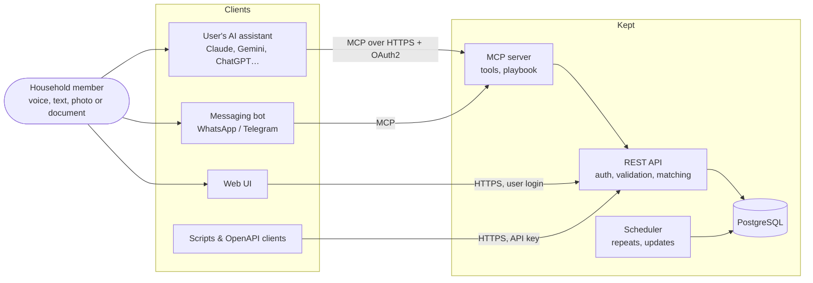
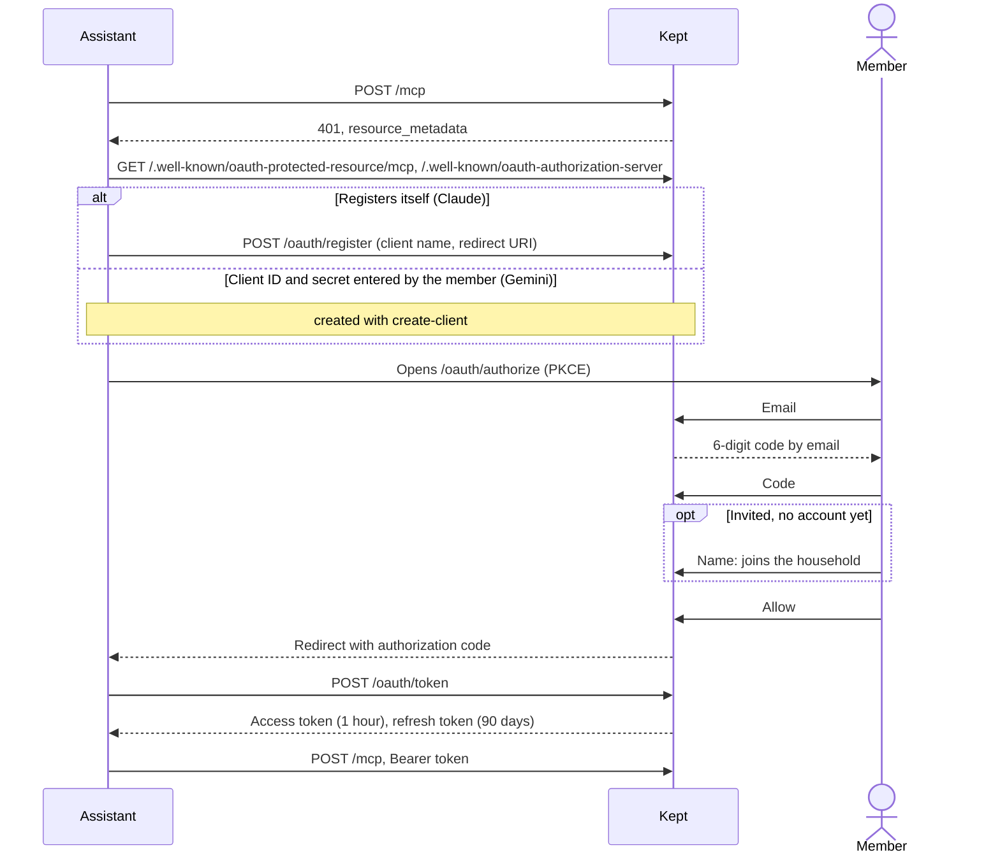

# Kept: Implementation

How Kept is built. What it does and why lives in `VISION.md`.

## 1. Architecture



Every client calls Kept as one household member, and every request goes through the REST API, which authenticates the caller, validates the request, runs [matching](VISION.md#one-purchase-many-sources) and filters what the caller may see. The MCP server is the main way agents talk to the ledger. It is a thin layer over the REST API and holds no business logic of its own. The web UI, scripts and anything that doesn't speak MCP use the REST API directly. One deployment serves many households from one PostgreSQL database. Every household-scoped row carries `household_id`, and the REST API scopes every query to the caller's household and, for transactions, to the caller. The scheduler creates [repeats](VISION.md#35-repeating-spending-phone-rent-subscriptions) on their dates and records updates for the agent to announce. The sequence diagrams in `VISION.md` §3 show the REST calls underneath each tool.

### 1.1 Why MCP and Not Only REST

Kept's own code (the web UI, scripts, the messaging bot) can call a REST API directly. The assistants people already have on their phones can't, and those assistants are the main clients.

- **It's how assistants accept custom tools.** In Claude, Gemini, Grok and Perplexity, adding a custom connector means pasting an MCP server URL. None of them lets a user connect a REST API. ChatGPT's custom GPT Actions are the one exception that takes an OpenAPI spec, which is why the [OpenAPI spec](VISION.md#other-clients) is still published. Without MCP, Kept would need a separate app or bot for each assistant.
- **It carries the playbook, not just the data.** The product is the agent's behavior (see [§5.2](#52-teaching-the-agent)). MCP has places for it: tool descriptions written for the model, server instructions, prompts and resources. A REST API only has endpoints and developer documentation, so each user would have to paste a long system prompt into every assistant they use.
- **Each member signs in with their own account.** MCP defines how an assistant signs a user in with OAuth2, including registering itself with the server automatically. A member clicks "Connect" and signs in, and every tool call runs as that person, which [privacy](VISION.md#households-accounts-and-privacy) and `spent_by` depend on. A REST API would mean creating a key and pasting it into each assistant, where an assistant accepts one at all.
- **Assistants find the tools on their own.** When an assistant connects, it asks the server which tools exist and what each takes. No assistant needs integration code written for it.

The costs are real. MCP is young and the spec still changes. Assistants support it unevenly; most use only tools (see [§5.3](#53-uneven-client-support)). And it is one more layer to run. Keeping it a thin layer over REST limits all three: the business logic, matching and authorization live in the REST API, and the MCP server only describes and forwards.

## 2. Data Model

**Households**

| Field  | Type   | Required | Example       |
| ------ | ------ | -------- | ------------- |
| `id`   | UUID   | Yes      |               |
| `name` | String | Yes      | The Smiths    |
| `currency` | String | Yes  | USD. Every amount in the ledger is in this currency. |
| `timezone` | String | Yes  | America/New_York. Sets "today" for logging and summaries; repeats are created on the date here. Owners change it. |
| `setup`    | JSON   | Yes  | State of each setup step ([`VISION.md` §3.6](VISION.md#36-first-conversation-setting-up)): `pending`, `done` or `later`, e.g. `{"basics": "done", "cost_centers": "done", "categories": "later", "watch": "pending", "invite": "pending"}`. |

**Users** (any number per household)

| Field          | Type   | Required | Notes                                                        |
| -------------- | ------ | -------- | ------------------------------------------------------------ |
| `id`           | UUID   | Yes      |                                                              |
| `household_id` | UUID   | Yes      | A user belongs to exactly one household.                     |
| `name`         | String | Yes      |                                                              |
| `email`        | String | Yes      | Sign-in for the web UI and OAuth2.                           |
| `role`         | String | Yes      | `owner` or `member`. Owners invite and remove members.       |
| `introduced_at` | Timestamp | No    | When the agent first introduced Kept to this member. Empty = run the introduction. |

**API Keys** (any number per user)

| Field          | Type      | Required | Notes                                                       |
| -------------- | --------- | -------- | ----------------------------------------------------------- |
| `id`           | UUID      | Yes      |                                                             |
| `user_id`      | UUID      | Yes      |                                                             |
| `key_hash`     | String    | Yes      | SHA-256 of the key. The key itself, `kept_…`, is shown once. |
| `name`         | String    | Yes      | E.g. "Laptop script".                                       |
| `last_used_at` | Timestamp | No       |                                                             |
| `revoked_at`   | Timestamp | No       |                                                             |

Every table carries a `household_id` for [row-level security](#4-security), including those whose rows belong to one member. Cost centers and categories are shared by every member. Transactions, notes and watched groups belong to their user (see [Households, Accounts and Privacy](VISION.md#households-accounts-and-privacy)).

**Categories** (shared by the household)

| Field          | Type   | Required | Example                              |
| -------------- | ------ | -------- | ------------------------------------ |
| `id`           | UUID   | Yes      |                                      |
| `household_id` | UUID   | Yes      |                                      |
| `path`         | String | Yes      | Groceries, Groceries/Alcohol, Car/Fuel |

Line items and watched groups store a link to the category's `id`, so renaming a category ("Car/Fuel" to "Car/Gas") doesn't break anything that uses it. The API and MCP tools accept and return the `path`, which is what the agent and the user see. The AI picks from this list and asks before adding a new one, so the household doesn't end up with "Car/Fuel", "Gas" and "Fuel" side by side. A write naming an unknown category or cost center fails with `unknown_category` or `unknown_cost_center`, listing the `known` names and the `similar` ones: a typo, swapped letters, a shorter form or another form of the word ([`VISION.md` §3.1](VISION.md#step-4-clarify-the-cost-center)).

Renaming a category or cost center keeps every link. Repeat templates and `checked_groups` hold paths and names as text, so a rename rewrites them, and a category's subcategories move with it. A delete fails with `409 in_use`, naming the counts, while any purchase, subcategory, watched group or repeat uses the name. A new household starts with the fixed seed in [`VISION.md` §3.6](VISION.md#36-first-conversation-setting-up).

**Invites**

| Field          | Type      | Required | Notes                                                       |
| -------------- | --------- | -------- | ----------------------------------------------------------- |
| `id`           | UUID      | Yes      |                                                             |
| `household_id` | UUID      | Yes      |                                                             |
| `email`        | String    | Yes      |                                                             |
| `invited_by`   | UUID      | Yes      | An owner. Set from the authenticated identity.              |
| `token_hash`   | String    | Yes      | Hash of the emailed token, for `POST /api/v1/invites/accept`. |
| `expires_at`   | Timestamp | Yes      |                                                             |
| `accepted_at`  | Timestamp | No       | Set when the invitee joins as a `member`: by signing in from an assistant ([§5.4](#54-connecting-an-assistant)) or with the token. |

**Transactions** (one row per payment)

| Field      | Type      | Required | Notes                                                              |
| ---------- | --------- | -------- | ------------------------------------------------------------------ |
| `id`       | UUID      | Yes      |                                                                    |
| `date`     | Date      | Yes      | Local date where the purchase happened. Reports group by this date, so a purchase at 11pm on Dec 31 in New York counts in December. |
| `occurred_at` | Timestamp (UTC) | No | Exact moment, when known (receipt, email, card statement). Always stored in UTC. |
| `timezone` | String    | Yes      | IANA name where the purchase happened, e.g. `Asia/Tokyo`. Defaults to the household's time zone. |
| `amount`   | Decimal   | Yes      | In the household currency. A purchase in another currency is converted at the time of purchase, and the original amount and rate go in `notes`, e.g. "¥4,800 at 148.15 JPY/USD". |
| `spent_by` | UUID      | Yes      | Owner of the transaction. Set from the authenticated identity.     |
| `private`  | Boolean   | Yes      | Default false. Private transactions are left out of household totals. |
| `merchant` | String    | No       |                                                                    |
| `notes`    | Text      | No       |                                                                    |
| `repeat_id` | UUID     | No       | Set when the transaction was created by a [repeat](VISION.md#35-repeating-spending-phone-rent-subscriptions). |
| `checked_groups` | List of strings | No | Watched groups the user answered about or a receipt covered, e.g. `["Groceries/Alcohol", "snacks"]`. A checked group with no line item is a known $0. Groups with a line item are added on every write. Used for [coverage](VISION.md#coverage). |
| `main_category` | Category link | No | The category sent as the top-level `category`: the single line's, or the rest line's beside explicit line items. |
| `user_edited` | List of strings | No | Fields the user changed with `PATCH`: `amount`, `date`, `merchant`, `line_items`. A later source never changes them ([§3.2](#32-matching)). |

Time zones: every timestamp is stored in UTC, and each transaction also keeps the IANA time zone and the local date where it happened. The zone name (not an offset like `+09:00`) is kept so local time can always be rebuilt, including across daylight saving changes. The agent uses the user's time zone unless the conversation or the source says otherwise: "dinner in Tokyo", a foreign receipt, or a card charge with a foreign merchant location. When a purchase looks like it was made abroad, the agent includes the place and the converted amount in the confirmation: "Log ¥4,800 ($32.40) at Ichiran, Tokyo, yesterday?"

**Line Items** (what the payment was for; at least one per transaction, summing to the transaction amount)

| Field            | Type                      | Required | Notes                                               |
| ---------------- | ------------------------- | -------- | --------------------------------------------------- |
| `id`             | UUID                      | Yes      |                                                     |
| `transaction_id` | UUID                      | Yes      |                                                     |
| `amount`         | Decimal                   | Yes      |                                                     |
| `category`       | Category link             | Yes      | Sent and returned as the `path`, e.g. "Car/Fuel".   |
| `item`           | String                    | No       | Free text, e.g. "snacks", "shoes". Empty for the rest line. |
| `spent_for`      | List of cost center links | No       |                                                     |
| `notes`          | Text                      | No       | Details, e.g. "chips, cookies".                   |
| `is_rest`        | Boolean                   | Yes      | The rest line, which absorbs a change of total.     |
| `position`       | Integer                   | Yes      | Order within the transaction.                       |

**Cost Centers**

| Field        | Type            | Required | Example                    |
| ------------ | --------------- | -------- | -------------------------- |
| `id`         | UUID            | Yes      |                            |
| `household_id` | UUID          | Yes      |                            |
| `name`       | String          | Yes      | Kia, House, Zoe, Rex    |
| `kind`       | String          | Yes      | Car, Home, Child, Pet. Tells the agent which purchases it could be for. |

**Sources** (what was read behind a transaction; see [Sources](VISION.md#34-sources-anything-the-users-ai-can-read))

| Field                  | Type      | Required | Notes                                                                       |
| ---------------------- | --------- | -------- | --------------------------------------------------------------------------- |
| `id`                   | UUID      | Yes      |                                                                             |
| `transaction_id`       | UUID      | Yes      |                                                                             |
| `user_id`              | UUID      | Yes      | Who the source belongs to.                                                  |
| `kind`                 | String    | Yes      | `talk`, `photo`, `document`, `email`, `statement`, `other`                  |
| `received_at`          | Timestamp | Yes      |                                                                             |
| `extracted`            | JSON      | No       | What was read from it: amount, date, merchant, line detail, account number. Its `amount` keeps identifying the purchase after the user edits the transaction. |

**Repeats** (see [Repeating Spending](VISION.md#35-repeating-spending-phone-rent-subscriptions))

| Field             | Type    | Required | Notes                                                                       |
| ----------------- | ------- | -------- | --------------------------------------------------------------------------- |
| `id`              | UUID    | Yes      |                                                                             |
| `user_id`         | UUID    | Yes      | Owner; repeated transactions get this user as `spent_by`.                   |
| `template`        | JSON    | Yes      | The transaction to create: amount, merchant, line items, `spent_for`, `private`. The amount is updated to the most recent real amount. |
| `frequency`       | String  | Yes      | `weekly`, `monthly` or `yearly`.                                            |
| `interval`        | Integer | Yes      | Default 1. E.g. 2 with `weekly` = every two weeks.                          |
| `anchor`          | Date    | Yes      | First occurrence; sets the weekday, day of month or date of year.           |
| `next_date`       | Date    | Yes      |                                                                             |
| `ends_on`         | Date    | No       |                                                                             |
| `remaining`       | Integer | No       | Occurrences left. A repeat past its end or count is deleted.                |
| `paused`          | Boolean | Yes      | Default false.                                                              |

**Updates** (what the ledger did on its own, announced by the agent)

| Field            | Type      | Required | Notes                                                            |
| ---------------- | --------- | -------- | ---------------------------------------------------------------- |
| `id`             | UUID      | Yes      |                                                                  |
| `user_id`        | UUID      | Yes      | Only this user sees it.                                          |
| `kind`           | String    | Yes      | `repeat_registered`, `possible_duplicate`                        |
| `text`           | Text      | Yes      | E.g. "Registered repeating phone expense, $50."                  |
| `transaction_id` | UUID      | No       | The transaction created, or the new one of a possible duplicate. |
| `other_transaction_id` | UUID | No      | For `possible_duplicate`: the purchase it may duplicate.         |
| `created_at`     | Timestamp | Yes      |                                                                  |
| `seen_at`        | Timestamp | No       | Set by `POST /api/v1/updates/seen` once the agent or web UI has shown it. |

**Line Item Cost Centers** (join table behind `spent_for`)

| Field            | Type    | Required | Notes                                                              |
| ---------------- | ------- | -------- | ------------------------------------------------------------------ |
| `line_item_id`   | UUID    | Yes      |                                                                    |
| `cost_center_id` | UUID    | Yes      |                                                                    |
| `share`          | Decimal | No       | Fraction of the line item amount (0–1). Empty = even split of the remainder. |

**Watched Groups** (personal; see [`VISION.md` §3.3](VISION.md#33-watched-groups-alcohol-and-snacks))

| Field        | Type          | Required | Notes                                                    |
| ------------ | ------------- | -------- | -------------------------------------------------------- |
| `id`         | UUID          | Yes      |                                                          |
| `user_id`    | UUID          | Yes      | Set from the authenticated identity.                     |
| `category`   | Category link | No       | Exactly one of `category` and `item`.                    |
| `item`       | String        | No       | E.g. "snacks".                                           |

**Caps** (personal; see [Caps](VISION.md#caps))

| Field         | Type             | Required | Notes                                                      |
| ------------- | ---------------- | -------- | ---------------------------------------------------------- |
| `id`          | UUID             | Yes      |                                                            |
| `user_id`     | UUID             | Yes      | Set from the authenticated identity.                       |
| `category`    | Category link    | No       | Exactly one of `category` and `cost_center`. Subcategories count toward it. |
| `cost_center` | Cost center link | No       |                                                            |
| `amount`      | Decimal          | Yes      | In the household currency.                                 |
| `period`      | String           | Yes      | `month` or `year`, the calendar one in the household's time zone. |

**Notes** (personal; see [Notes](VISION.md#notes))

| Field        | Type      | Required | Notes                                                            |
| ------------ | --------- | -------- | ---------------------------------------------------------------- |
| `id`         | UUID      | Yes      |                                                                  |
| `user_id`    | UUID      | Yes      | Set from the authenticated identity.                             |
| `text`       | Text      | Yes      | In the user's words, e.g. "Costco is always groceries."          |
| `created_at` | Timestamp | Yes      |                                                                  |

## 3. REST API

| Method | Endpoint                      | Description                                                                                       |
| ------ | ----------------------------- | ------------------------------------------------------------------------------------------------- |
| `POST` | `/api/v1/transactions`        | Add one entry, or several as `{"transactions": [...]}`, each with optional line items and a source. Each entry is [matched](VISION.md#one-purchase-many-sources) against the caller's existing transactions; the response says whether it was attached or created. |
| `GET`  | `/api/v1/transactions`        | List the caller's own transactions, newest first, with the `count` and `total` of everything that matches. Filters: dates, `merchant`, `item`, `q` (merchant or item), `private`, repeated `category` (with subcategories), `category_only`, `cost_center` and `no_cost_center`; paged by `limit` and `offset`. Used by the AI for best guesses and by the web UI. Never returns other members' transactions. |
| `GET`    | `/api/v1/transactions/{id}` | One of the caller's transactions.                                                                 |
| `PATCH`  | `/api/v1/transactions/{id}` | Edit one of the caller's transactions, including marking it private.                              |
| `DELETE` | `/api/v1/transactions/{id}` | Delete one of the caller's transactions.                                                          |
| `GET`  | `/api/v1/cost-centers`        | List the household's cost centers (cars, homes, kids, pets) with their kind.                      |
| `POST`   | `/api/v1/cost-centers`      | Add a cost center for the household.                                                              |
| `PATCH`  | `/api/v1/cost-centers`      | Rename a cost center or change its kind: `{"name", "new_name"?, "kind"?}`.                       |
| `DELETE` | `/api/v1/cost-centers?name=` | Delete a cost center nothing uses.                                                               |
| `GET`    | `/api/v1/categories`        | List the household's categories and subcategories.                                                |
| `POST`   | `/api/v1/categories`        | Add a category or subcategory for the household.                                                  |
| `PATCH`  | `/api/v1/categories`        | Rename or move a category with its subcategories: `{"path", "new_path"}`.                         |
| `DELETE` | `/api/v1/categories?path=`  | Delete a category nothing uses.                                                                   |
| `GET`    | `/api/v1/connections`       | The caller's connected assistants and web sign-ins, one per client, with when each was last used. |
| `DELETE` | `/api/v1/connections/{client_id}` | Disconnect one: its grants and tokens are deleted, so it has to sign in again.              |
| `POST`   | `/api/v1/connections/clients` | Create a client ID and secret for an assistant that asks for them, with its redirect URI. The secret is shown once. |
| `GET`    | `/api/v1/watches`           | List the caller's watched groups.                                                                 |
| `POST`   | `/api/v1/watches`           | Watch a category or an item. Watching one already watched returns it.                             |
| `DELETE` | `/api/v1/watches/{id}`      | Stop watching, e.g. "stop tracking snacks".                                                       |
| `GET`    | `/api/v1/questions`         | Kept's open questions for the caller, most important first: possible duplicates, caps passed, recurring charges missing from a statement, API keys unused for a year. |
| `POST`   | `/api/v1/questions/{id}/answer` | Answer one: `merge` or `different`; `remove` or `keep`; `stop` or `still_paying`; `revoke` or `keep`. "Keep" on a cap silences it for the period; on a key, for a year. |
| `POST`   | `/api/v1/repeats/{id}/missing` | Record that a statement lacked this recurring charge, as an open question. |
| `GET`    | `/api/v1/caps`              | The caller's caps with `spent` this month or year (own purchases, private included) and `state`: `under`, `close` (from 80%) or `over`. |
| `POST`   | `/api/v1/caps`              | Set a cap. `PATCH` and `DELETE` on `/api/v1/caps/{id}` change or remove one. A write that takes a cap past 80% or over returns the lines to say in `caps`. |
| `GET`    | `/api/v1/notes`             | List the caller's notes, newest first.                                                            |
| `POST`   | `/api/v1/notes`             | Save a note.                                                                                      |
| `PATCH`  | `/api/v1/notes/{id}`        | Change a note's text.                                                                             |
| `DELETE` | `/api/v1/notes/{id}`        | Delete a note.                                                                                    |
| `POST`   | `/api/v1/transactions/{id}/sources` | Attach a source (what the agent read from a photo, document or email) to one of the caller's transactions, e.g. a receipt added later. |
| `POST`   | `/api/v1/transactions/{id}/merge` | Merge another of the caller's transactions into this one, keeping both sets of sources.     |
| `GET`    | `/api/v1/repeats`           | The caller's repeats with next date, amount, who they're for and the last purchase each logged, plus this `month`'s recurring `total` and how much is still `to_come`. |
| `POST`   | `/api/v1/repeats`           | Make a transaction repeat on a schedule.                                                          |
| `PATCH`  | `/api/v1/repeats/{id}`      | Change the amount, schedule or end date from the next occurrence, or pause it.                    |
| `DELETE` | `/api/v1/repeats/{id}`      | Stop repeating. Transactions already created are kept.                                            |
| `GET`    | `/api/v1/updates`           | What the ledger did on its own since the caller last checked: repeats registered, plus possible duplicates still to resolve. |
| `POST`   | `/api/v1/updates/seen`      | Mark updates as shown.                                                                            |
| `GET`    | `/api/v1/setup`             | The household's setup steps and whether the caller has been introduced.                          |
| `PATCH`  | `/api/v1/setup`             | Save confirmed setup answers: the household's name, currency and time zone (owners), step states, the introduction. The response's `currency_locked` says the first purchase fixed the currency. |
| `PATCH`  | `/api/v1/me`                | Change the caller's own name.                                                                     |
| `GET`    | `/api/v1/members`           | The household's members and open invites.                                                         |
| `PATCH`  | `/api/v1/members/{id}`      | Owners only: make someone an owner or a member. A household keeps at least one owner.             |
| `DELETE` | `/api/v1/members/{id}`      | Owners only: remove a member and everything they logged; never the last owner.                    |
| `POST`   | `/api/v1/invites`           | Owners only. Invite a member by email; Kept emails them the address to add to their assistant.    |
| `DELETE` | `/api/v1/invites/{id}`      | Cancel an invite that hasn't been accepted.                                                       |
| `POST`   | `/api/v1/invites/accept`    | No API key. Accept with the token from the link: creates the member and returns their first API key. |
| `GET`    | `/api/v1/api-keys`          | The caller's active API keys.                                                                     |
| `POST`   | `/api/v1/api-keys`          | Create an API key for the caller, shown once.                                                     |
| `DELETE` | `/api/v1/api-keys/{id}`     | Revoke one of the caller's API keys.                                                              |
| `GET`  | `/api/v1/expenses/summary`    | Query monthly and yearly totals by category, subcategory, cost center or item (e.g., fuel per car, alcohol per month). `scope=me` covers the caller's own purchases, private included; `scope=household` covers every member's non-private purchases, never broken down by member. Watched groups include their [coverage](VISION.md#coverage). |

Errors have one shape, `{"error": {"code", "message", "details"?}}`: 400 for a malformed request, 401 without a valid key, 403 for an owner-only action, 404 for anything outside the caller's own data, 409 for a conflict, 410 for a used or expired invite, and 422 when the ledger's rules reject it. A category or cost center the household doesn't have is rejected (`unknown_category`, `unknown_cost_center`, with the known ones in `details`), so the agent asks before adding one. The server serves the OpenAPI spec at `/api/v1/openapi.json`.

### 3.1 Request Examples

**One line item.** A transaction with a single line item can use the top-level `category` and `spent_for` as a shorthand:

```http
POST /api/v1/transactions
Content-Type: application/json
Authorization: Bearer <api-key>

{
  "date": "2026-10-27",
  "timezone": "America/New_York",
  "amount": 60.00,
  "category": "Car/Fuel",
  "spent_for": [{ "cost_center": "Kia" }]
}
```

The response has `result` (`created`, `attached` or `possible_duplicate`, §3.2), the `transaction`, and `warnings` when the date may be a slip ([`VISION.md` §3.1](VISION.md#step-7-feedback)).

**Several line items** ([`VISION.md` §3.2](VISION.md#32-mixed-purchase-several-things-in-one-payment)). The agent sends only the explicit line items; the ledger adds the rest line:

```json
{
  "date": "2026-10-27",
  "amount": 40.00,
  "merchant": "Target",
  "category": "Groceries",
  "line_items": [
    { "amount": 22.00, "category": "Clothing", "item": "shoes", "spent_for": [{ "cost_center": "Zoe" }] },
    { "amount": 12.00, "category": "Housing", "item": "bath curtains", "spent_for": [{ "cost_center": "House" }] }
  ]
}
```

The API rejects line items that add up to more than the transaction amount.

**Shared cost centers** ([`VISION.md` §4.A](VISION.md#splitting-shared-expenses)). Each `spent_for` entry may carry a `share`. Entries without one divide whatever is left evenly:

```json
"spent_for": [
  { "cost_center": "Hyundai", "share": 0.58 },
  { "cost_center": "Kia" }
]
```

The API rejects shares that add up to more than 1, shares that leave nothing for entries without one, and shares that add up to less than 1 when every entry has one.

### 3.2 Matching

Every write runs matching against the caller's transactions within 7 days of its date ([`VISION.md` §3.4](VISION.md#one-purchase-many-sources)). The rules are pure functions in `src/domain/matching.ts`.

| Candidate                                                     | Same merchant | Merchant unknown            |
| ------------------------------------------------------------- | ------------- | --------------------------- |
| Same amount, as the current amount or any source's            | Clear         | Clear within a day, else unclear |
| Within $1.50 or 3%                                            | Clear         | Unclear                     |
| Created by a repeat, within 50%                               | Clear         | —                           |
| Within 25%, e.g. a tip                                        | Unclear       | —                           |

- **Window:** 4 days apart, 7 for a transaction created by a repeat.
- **Same kind never matches.** A candidate that already has a source of the incoming kind is another purchase: two statement lines are two charges.
- **Merchants** are "same" when their normalized names match, contain one another or share a word of four letters or more. Two names that don't match are "different", so no match, unless one looks like a card descriptor (`*`, `#`, three digits in a row, or all capitals); then the relation is "unknown".
- **One clear candidate** is attached. Several clear ones, or only unclear ones, create a new transaction and a `possible_duplicate` update naming the closest candidate.

Attaching reconciles field by field. A source changes a field only when it is more trusted for it than every source already attached, and never a field in `user_edited`; the response lists each change and each field kept with its reason.

| Field                     | Most to least trusted                                    |
| ------------------------- | -------------------------------------------------------- |
| Amount and date           | Statement, then photo, document or email, then talk      |
| Merchant                  | Photo, document or email, then talk, then statement      |
| Line items, categories, cost centers | Photo, document or email, then talk, then statement |

A changed total resizes the rest line; if the explicit line items would exceed the new total, the amount is kept and reported. `private` only turns on from a new source. When the transaction came from a repeat, a changed amount also becomes the repeat's amount.

## 4. Security

Every request except sign-in and discovery carries a bearer token: a member's API key, or an OAuth2 access token issued to an assistant for the MCP address ([§5.4](#54-connecting-an-assistant)). The REST API and `/mcp` accept both. A request without a valid one gets 401 with `WWW-Authenticate: Bearer resource_metadata="…"`, which tells an MCP client where to sign in.

Each household member gets their own API key or OAuth2 login. The ledger sets `spent_by` from the authenticated identity on every write, so the AI never sends it and can't spoof it. A single key shared by the whole household would make every entry look like the same person, and break [privacy](VISION.md#households-accounts-and-privacy), so keys must be per user. Every read is filtered by the caller's identity on the server, not by the client.

API keys look like `kept_…` and only their SHA-256 hash is stored. Members created by an invite get their first key when they accept it.

PostgreSQL row-level security backs up the filtering in code. Every household-scoped table has a policy that admits only rows whose `household_id` matches the `app.household_id` setting, and each request runs in a transaction that sets it from the authenticated identity with `set_config(..., true)`. The server connects as a role that doesn't own the tables and has no `BYPASSRLS`, so a query missing its household filter returns nothing instead of another household's rows. Filtering by member within a household stays in the REST API. Four `SECURITY DEFINER` functions run as the table owner for lookups made before the household is known: authenticating a key, finding an invite by its token, checking whether an email has an account, and listing repeats due across households for the scheduler.

## 5. MCP Server

The MCP server is stateless Streamable HTTP at `POST /mcp`, in the same process as the REST API. A request is authenticated like any REST call, by its bearer token, so every tool call runs as that member. Each tool forwards to its REST route in-process with the same `Authorization` header and returns the JSON response; a REST error comes back as a tool error with the same `{"error": …}` body, which tells the agent what to fix (an unknown category lists the known ones). Responses are plain JSON, with no session and no server-initiated stream, so `GET` and `DELETE /mcp` return 405.

### 5.1 Tools

| Tool                  | REST call underneath           | Purpose                                                                   |
| --------------------- | ------------------------------ | ------------------------------------------------------------------------- |
| `log_transaction`     | `POST /api/v1/transactions`    | Write one or more transactions with optional line items, `spent_for` shares, `private` and a source. Returns whether each matched an existing purchase. |
| `list_transactions`   | `GET /api/v1/transactions`     | Recent history, used to infer category, merchant, cost center and items.  |
| `edit_transaction`    | `PATCH /api/v1/transactions/{id}` | Change a purchase after the user confirmed, e.g. a return.             |
| `delete_transaction`  | `DELETE /api/v1/transactions/{id}` | Delete a purchase after the user confirmed.                           |
| `list_cost_centers`   | `GET /api/v1/cost-centers`     | Cost centers with their kind.                                             |
| `watch_group`         | `POST /api/v1/watches`         | Start watching a category or item, after the user asked.                  |
| `stop_watching`       | `DELETE /api/v1/watches/{id}`  | Stop watching a group.                                                    |
| `answer_question`     | `POST /api/v1/questions/{id}/answer` | Record the user's answer to an open question.                       |
| `flag_missing_charge` | `POST /api/v1/repeats/{id}/missing` | Keep a missing recurring charge as an open question.                 |
| `set_cap`             | `POST /api/v1/caps`            | Set a cap the user confirmed.                                             |
| `change_cap`          | `PATCH /api/v1/caps/{id}`      | Change a cap's amount or period.                                          |
| `remove_cap`          | `DELETE /api/v1/caps/{id}`     | Remove a cap.                                                             |
| `save_note`           | `POST /api/v1/notes`           | Remember something the user said, after telling them.                     |
| `update_note`         | `PATCH /api/v1/notes/{id}`     | Change a note's text.                                                     |
| `delete_note`         | `DELETE /api/v1/notes/{id}`    | Forget a note.                                                            |
| `add_source`          | `POST /api/v1/transactions/{id}/sources` | Attach what the agent read from a photo, document or email to an existing transaction, e.g. a receipt added later. |
| `merge_transactions`  | `POST /api/v1/transactions/{id}/merge` | Merge a duplicate after the user agrees they're the same purchase. |
| `set_repeat`          | `POST /api/v1/repeats`         | Make a transaction repeat, after the user confirms the schedule.          |
| `list_repeats`        | `GET /api/v1/repeats`          | The user's repeats with next date and amount.                             |
| `update_repeat`       | `PATCH /api/v1/repeats/{id}`   | Change, pause or resume a repeat.                                         |
| `stop_repeat`         | `DELETE /api/v1/repeats/{id}`  | Stop a repeat.                                                            |
| `get_updates`         | `GET /api/v1/updates`, `POST /api/v1/updates/seen` | What happened since the user last talked to the agent; called at the start of a conversation. Marks what it returns as seen. |
| `get_summary`         | `GET /api/v1/expenses/summary` | Totals by category, cost center or item for a period, with coverage for watched groups. |
| `add_cost_center`     | `POST /api/v1/cost-centers`    | Add a cost center the user confirmed.                                     |
| `add_category`        | `POST /api/v1/categories`      | Add a category or subcategory the user confirmed.                         |
| `rename_cost_center`  | `PATCH /api/v1/cost-centers`   | Fix a cost center's name the user confirmed.                              |
| `delete_cost_center`  | `DELETE /api/v1/cost-centers`  | Delete a cost center nothing uses, after the user confirmed.              |
| `rename_category`     | `PATCH /api/v1/categories`     | Rename or move a category the user confirmed.                             |
| `delete_category`     | `DELETE /api/v1/categories`    | Delete a category nothing uses, after the user confirmed.                 |
| `update_setup`        | `PATCH /api/v1/setup`          | Save confirmed setup answers and mark steps `done` or `later`.            |
| `invite_member`       | `POST /api/v1/invites`         | Invite a member by email, after the user confirms. Owners only.           |
| `get_playbook`        | `GET /api/v1/notes`, `/watches`, `/categories`, `/cost-centers`, `/setup` | The question playbook plus the household's categories and cost centers, the user's current notes, watched groups, caps and open questions, and setup state in one call. Called before the first question; when setup is incomplete or the caller hasn't been introduced, the playbook tells the agent to run the first conversation. |

### 5.2 Teaching the Agent

Which MCP mechanism carries each part of the playbook in [`VISION.md` §4.B](VISION.md#how-kept-teaches-the-agent):

| What the agent learns       | MCP mechanism        |
| --------------------------- | -------------------- |
| The question playbook       | Server instructions  |
| When to call each tool      | Tool descriptions; e.g. `log_transaction` is only called after the user confirms the final record |
| The household's vocabulary  | Resource `kept://household` |
| Setting up                  | The setup state from `get_playbook`, which starts it in every assistant; prompt `setup_household` where supported |
| Logging an expense          | Prompt `log_expense` |
| Catching up                 | Prompt `catch_up`    |

The playbook text is one source, `src/mcp/playbook.ts`: the server instructions, and `get_playbook`'s `playbook` field. `get_playbook` also returns `start_with`: the first-member or new-member path of [`VISION.md` §3.6](VISION.md#36-first-conversation-setting-up) while setup is unfinished or the caller hasn't been introduced, the remaining steps for an owner who left some pending, or nothing.

Server instructions, resources and prompts are the preferred mechanisms, but not every assistant supports them (see [§5.3](#53-uneven-client-support)). Each one has a tool equivalent: `get_playbook` returns the playbook and the vocabulary, and the tool descriptions say when to call it. That way an assistant that only calls tools still follows the playbook.

### 5.3 Uneven Client Support

Which assistants support what is in [`VISION.md` §4.B](VISION.md#supported-assistants). This shapes the server:

- **Everything works through tools.** Every client calls MCP tools, but support for server instructions, resources and prompts is uneven. Claude uses all of them; most others mostly call tools. So the playbook and the household vocabulary are also available from the `get_playbook` tool (see [§5.2](#52-teaching-the-agent)).
- **Tool descriptions carry the playbook.** Where server instructions are ignored, the description is the only guidance the model gets. "Call `get_playbook` before asking the user anything about an expense" has to be in the tool descriptions themselves.
- **Reads work everywhere, writes may not.** If an assistant's phone app blocks write tools (as reported for ChatGPT on iOS), the user can still ask about spending there but has to log from the web or another assistant. The [messaging bot](VISION.md#other-clients) is the fallback.

### 5.4 Connecting an Assistant

A member adds `<PUBLIC_URL>/mcp` as a custom connector in their assistant's web settings ([`VISION.md` §4.B](VISION.md#supported-assistants)). The assistant finds Kept's authorization server, registers itself or uses a client created ahead of time, and signs the member in:



- **The code is typed, not clicked.** On a phone, the assistant's sign-in browser and the mail app's browser are different, so an emailed link arrives without the sign-in session. The email also carries a link, which works in the same browser. A code expires after 10 minutes or 5 wrong tries.
- **Sign-in doesn't reveal accounts.** An email with no account and no open invite gets the same "check your email" page and no code.
- **Invited people join by signing in.** Every email gets a code. A verified email with no account and no invite gets the create-household form and becomes its owner (`kept_create_household`). A verified email with an open invite and no account gets a page for their name, then joins as a `member`; their assistant then runs the new-member path of [`VISION.md` §3.6](VISION.md#36-first-conversation-setting-up).
- **Tokens:** PKCE with S256 is required. Access tokens are opaque, bound to `<PUBLIC_URL>/mcp` and scope `kept`; a request with no scope gets `kept`. Refresh tokens rotate and don't end with the browser session, so the assistant stays connected.
- **Metadata:** `/.well-known/oauth-authorization-server` serves the OAuth part of the OpenID document at `/.well-known/openid-configuration`: the `code` flow only, scope `kept`, and `protected_resources` pointing back to `/mcp`.
- **The web UI** signs in as the built-in public client `kept-web` with PKCE, redirecting to `<PUBLIC_URL>/app/callback`. It skips the consent page, and asks with `prompt=login`, so every sign-in takes an emailed code and signing out on a shared computer holds. The refresh token stays in `localStorage` and the access token in memory; refreshes run under a Web Lock, because two tabs rotating one refresh token would revoke it.
- **Clients created ahead of time:** Gemini asks for a client ID and secret instead of registering. Its redirect URI, shown under "Copy redirect URI" in its dialog, contains the member's Google account and Kept's host name, so each member creates their own client on the web UI's Me page (`POST /api/v1/connections/clients`); `create-client` does the same from the command line.
- **Connections** are a member's grants grouped by client. Disconnecting deletes the grants and their tokens.
- **State** (clients, grants, sessions, codes, tokens) lives in `oauth_models`, and sign-in codes in `sign_in_codes`, hashed. Neither belongs to a household, so neither has row-level security. `SECURITY DEFINER` functions find a user or an open invite by email and a user's household before the household is known.

## 6. Stack and Deployment

- **Server:** TypeScript on Node with Fastify. Route schemas validate requests and generate the OpenAPI spec (§3). The MCP server uses the official MCP TypeScript SDK.
- **Database:** PostgreSQL, one database for every household (§1).
- **Database access:** Kysely for typed queries and migrations.
- **Hosting:** one VPS running Docker Compose: PostgreSQL, the Kept server with its scheduler, and Caddy in front for HTTPS with automatic certificates. Assistants' connectors need the public HTTPS URL ([`VISION.md` §4.B](VISION.md#supported-assistants)). The server applies migrations on start. The host needs a domain name of its own: Gemini rejects wildcard IP names such as `sslip.io` before sign-in starts.
- **OAuth2:** Kept runs its own authorization server, with no identity vendor, built on `oidc-provider` ([§5.4](#54-connecting-an-assistant)). Its signing key and cookie secret are created on first start and kept in `oauth_keys`. Emails go through a `Mailer`: Resend's HTTP API when `RESEND_API_KEY` is set, sending from `MAIL_FROM` (by default `noreply@` the host), otherwise the server log. When a sign-in code can't be sent, the email page asks the member to try again.
- **`PUBLIC_URL`** is the address assistants reach. It is the OAuth2 issuer and, with `/mcp`, the resource every token is bound to, so it must match the deployed HTTPS address exactly.
- **Web UI:** React with React Router, built by Vite from `web/` into `dist/web` and served by the server at `/app/`, under a Content Security Policy that admits only its own files. It is a REST client like any other; what it decides (the purchase editor's form and validation, PKCE) lives in pure functions in `web/src/lib`.
- **Scheduler:** the server creates due repeats every 15 minutes (`SCHEDULER_INTERVAL_MS`), each on its owner's local date.