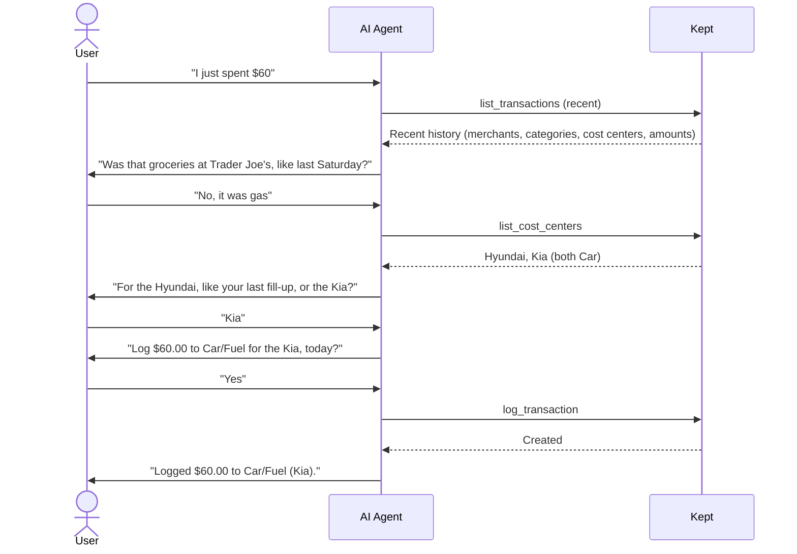
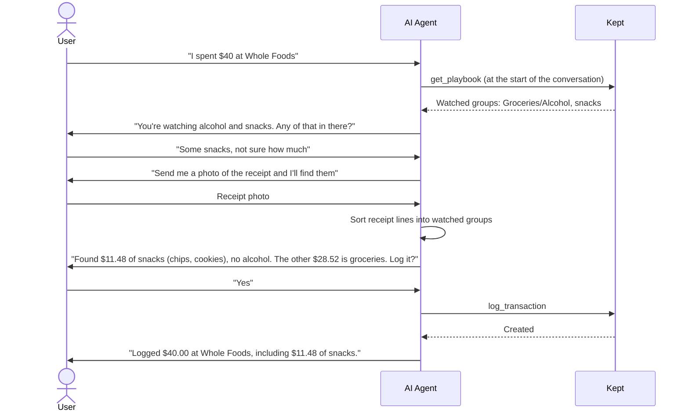
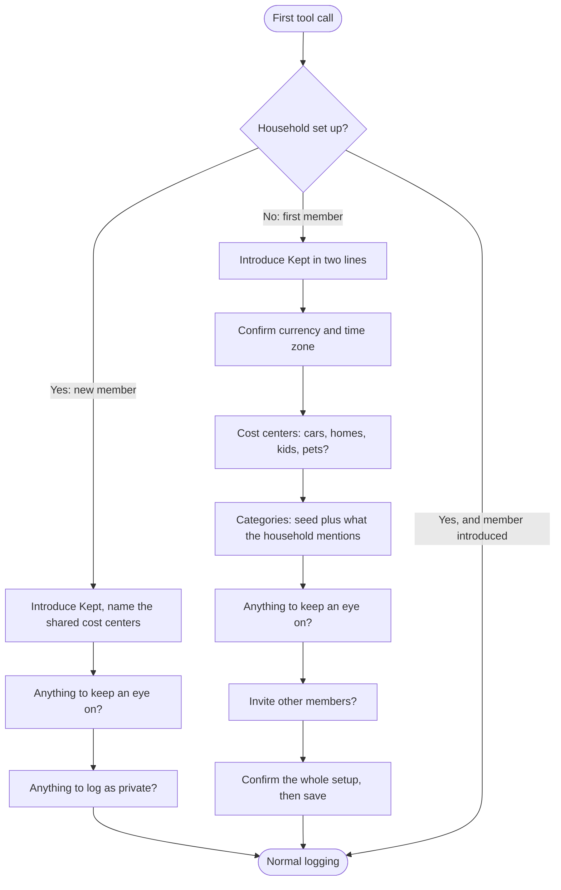

# Kept: Vision

Teach your AI agent to track your expenses: what to ask, and how to group the answers.

## 1. Core Problem & Concept

Traditional expense tracking applications suffer from high input friction. Manual data entry is tedious, receipt-scanning OCR is often inaccurate or too granular, and raw bank sync feeds result in cryptic descriptions that require manual categorization.

AI assistants remove the typing: a user can say "I just spent $60" and any assistant can turn that into JSON. What an assistant doesn't know is how *this household* tracks money. It doesn't know there are two cars and fuel is tracked per car, that the user wants to know what they spend on snacks, that Target runs are usually mixed, or that the car insurance splits 58/42. On its own, it either asks too many questions or files everything under a generic guess.

**The Solution:** Kept teaches the agent to be a good bookkeeper for one specific household. It gives the agent three things:

1. **A way to group spending.** Transactions, line items, categories, cost centers, watched groups (like alcohol or snacks) and the "rest" line, so every answer the user gives has a place to go (see [Data Flow Examples](#3-data-flow-examples)).
2. **A playbook of questions.** What to ask, in what order, and when to stay quiet: lead with the best guess, ask about cost centers only when there is a choice, ask about all watched groups in one question and only where they are sold, and always confirm before writing. Each member extends the playbook with their own notes.
3. **Memory of the household.** History the agent reads to make its guesses (the usual car, the last split, existing item names, which stores are mixed), plus each member's notes, such as "Costco is always groceries" or "we're selling the Kia in December." Memory lives in the ledger, not in any one assistant, so every assistant a member connects shares it.

The ledger stores the records, but the product is the behavior. Any capable assistant connected to Kept asks the right questions from day one and gets better as history builds up. Kept doesn't read banks, inboxes or receipts itself: the user's own AI does that, with whatever access the user chooses to give it, and Kept keeps what it learns.

## 2. Architecture & System Design

Kept is a ledger behind a REST API. Assistants reach it through a thin MCP server; the web UI and scripts call the REST API directly. Every request runs as one household member. [`IMPLEMENTATION.md` §1](IMPLEMENTATION.md#1-architecture) has the components and why MCP sits in front of REST.

## 3. Data Flow Examples

Users often remember only the amount. The AI fills in the rest, asks about anything it can't infer, and confirms before writing to the ledger.

The examples below use these terms:

- **Transaction:** one payment, as the card or bank sees it. For example, $40 at Target.
- **Line item:** what part of that payment was for. Every transaction has at least one. Each line item has its own category, cost centers and, optionally, an item.
- **Cost center:** anything the household tracks spending for, such as cars (Hyundai, Kia), homes (House, Apartment), kids (Zoe, Maya) or pets (Rex, Daisy). "Cost center" is Kept's internal term; users see "people & things", and the agent asks "who or what was it for?".
- **Category:** what kind of spending a line item is, such as Groceries or Car/Fuel. Categories can have subcategories, such as Groceries/Alcohol, which roll up into the parent in reports. A category has at most three levels, such as Groceries/Snacks/Chips; who a purchase is for belongs in a cost center, not in deeper categories.
- **Item:** free text naming a specific thing the user wants to track, such as "snacks". Item totals answer questions like "how much do I spend on snacks?", while category totals answer "how much do I spend on groceries?"
- **Watched group:** a subcategory or item a member wants to make decisions about, such as alcohol or snacks. The AI asks about watched groups where they are bought.

### 3.1 Amount Only: Fuel for One of Two Cars

The household has two cars, a Hyundai and a Kia, so a fuel expense also needs to know which car it was spent for.

#### Step 1: Capture

The user sends the minimum they know:

> "I just spent $60."

The AI extracts what is explicit and fills defaults:

| What             | Value            | Source              |
| ---------------- | ---------------- | ------------------- |
| Amount           | 60.00            | Stated              |
| Date             | Today            | Default             |
| Time zone        | America/New_York | Household default   |
| Currency         | USD              | Household currency  |
| Category         | *unknown*        | Needs inference     |
| Who or what for  | *unknown*        | Depends on category |
| Merchant         | *unknown*        | Optional            |

#### Step 2: Infer the category

The AI fetches recent transactions from the ledger and looks for patterns (similar amounts, day of week, frequent merchants) to propose the most likely category.

#### Step 3: Clarify the category

The AI proposes its best guess as a yes/no question, so the user only has to confirm or correct:

> **AI:** "Was that groceries at Trader Joe's, like last Saturday?"
>
> **User:** "No, it was gas."

If the user's answer is still ambiguous, the AI asks one more short question instead of guessing.

#### Step 4: Clarify the cost center

Each cost center has a kind, such as Car, Home, Child or Pet. Fuel is for a Car, and the household has two. It knows who is talking from the authenticated request (see [`IMPLEMENTATION.md` §4](IMPLEMENTATION.md#4-security)), checks which car this person usually fills up, and leads with that one:

> **AI:** "For the Hyundai, like your last fill-up, or the Kia?"
>
> **User:** "Kia."

With one car, the AI uses it without asking. When the user names someone ("trousers for Zoe"), that settles it. A purchase that isn't clearly for one kind, like groceries or clothes nobody was named for, gets no cost center and no question.

A name that isn't in the household is usually a typo, so the AI asks about it on its own before anything else, and adds a cost center or category only after a yes to that question:

> **AI:** "There's no Iva in the household. Did you mean Ivy, or is Iva someone new?"

The ledger refuses an unknown name instead of creating it, and suggests the existing names it resembles. A wrong name already saved is renamed, which keeps every purchase under it; a name is deleted only once nothing uses it.

An expense can be spent for more than one cost center. For example, a single car insurance bill that covers both cars is logged once with both the Hyundai and the Kia in `spent_for`. See [Splitting Shared Expenses](#splitting-shared-expenses) for how the amount is divided.

#### Step 5: Confirm

Before writing anything, the AI shows the final record:

> **AI:** "Log $60.00 to Car/Fuel for the Kia, today?"
>
> **User:** "Yes."

The AI says the date as "today", "yesterday" or a weekday and day, and reads a date without a year as the most recent one that isn't in the future.

#### Step 6: Submit

Only after confirmation does the AI call `log_transaction` ([`IMPLEMENTATION.md` §3.1](IMPLEMENTATION.md#31-request-examples) shows the request).

#### Step 7: Feedback

The ledger stores the entry, and the AI replies:

> "Logged $60.00 to Car/Fuel (Kia)."

If the date looks like a slip, the ledger still stores the entry but flags it, and the AI asks: "That's dated October 25, 2025, over a year ago. Right?" A date is flagged when it is in the future, or more than 60 days back for a purchase the user told about (statements and receipts are often old).

### 3.2 Mixed Purchase: Several Things in One Payment

One payment at a store that sells a bit of everything: milk and bread, shoes for Zoe, and curtains for the bathroom.

At a grocery-only store the AI assumes everything is groceries. At a mixed store it asks one specific question instead:

> **User:** "$40 at Target."
>
> **AI:** "All groceries, or anything else in there?"
>
> **User:** "Shoes for Zoe, $22, and bath curtains, $12."
>
> **AI:** "Log $40 at Target: Clothing $22 for Zoe, Housing $12 for the House, and $6 Groceries for the rest?"
>
> **User:** "Yes."

If the user answers "all groceries," the transaction is logged with a single line item and nothing else is asked.

The user only gives prices for the things that matter. Whatever is not explained becomes one **rest** line in the transaction's main category. The AI sends the explicit line items, and the ledger adds the rest.

Stored result:

| Amount | Category  | `spent_for` | Item          |
| ------ | --------- | ----------- | ------------- |
| $22.00 | Clothing  | Zoe         | shoes         |
| $12.00 | Housing   | House       | bath curtains |
| $6.00  | Groceries |             | *(rest)*      |

### 3.3 Watched Groups: Alcohol and Snacks

Some granularity is worth having. One line per product ("Organic 2% milk 1gal") is too much detail to act on, but a few groups a member picked because they will make decisions about them are useful: alcohol, snacks, meat, candy, coffee.

A **watched group** is either:

- a **subcategory**, such as `Groceries/Alcohol`, `Groceries/Meat` or `Groceries/Candy`, which rolls up into its parent category in reports, or
- an **item**, such as "snacks", which can cut across categories: chips at the gas station, cookies at Target.

The user sets one up in conversation ("I want to keep an eye on alcohol", "track how much I spend on snacks"), and the AI saves it as one of their watched groups. Watching is personal: each member picks their own groups. Groceries stays one category until someone watches something inside it. A watched group is asked about wherever it has been bought before, and in its parent category (for alcohol and snacks, Groceries) until there is history.

#### Asking

When a purchase is in a category or at a store where watched groups are bought, the AI names them in **one** question:

> **User:** "$95 at Whole Foods."
>
> **AI:** "You're watching alcohol and snacks. Any of that in there, and roughly how much?"
>
> **User:** "About $20 of wine, no snacks."
>
> **AI:** "Log $95 at Whole Foods: Alcohol $20, the other $75 groceries?"

Any answer works:

| User's answer                    | What is logged                                   | Groups checked     |
| -------------------------------- | ------------------------------------------------ | ------------------ |
| "About $20 of wine, no snacks"   | Alcohol $20, Groceries $75                       | Alcohol, snacks    |
| "No"                             | Groceries $95                                    | Alcohol, snacks    |
| "Some wine, not sure how much"   | AI offers a receipt scan (below)                 | Depends on scan    |
| "Skip"                           | Groceries $95                                    | None               |

- **One question for all watched groups,** never one per group.
- **Rough amounts are fine.** "About $20" is logged as $20. For decisions, a close number is far better than none.
- **"No" and "skip" are different.** "No" means the watched groups are known to be $0 in this purchase; "skip" means unknown. The ledger records which groups were checked, so reports can tell the difference (see [Coverage](#coverage)).
- **Only where it makes sense.** The AI asks at stores and in categories where the groups have been bought before, not at the gas station. If the user keeps skipping at one store, the AI asks less often there and says so.

#### Receipt scan

When the user isn't sure of the amounts, the AI offers to read the receipt:

- **It groups lines, it doesn't copy them.** Forty receipt lines become a few line items: one per watched group that appears, plus anything for a different category or cost center. Everything else goes into the rest line. This is what avoids the "too granular" problem of classic receipt OCR.
- **A receipt checks every watched group,** including the ones the user didn't mention, so "no alcohol" is recorded as a known $0.
- **Names stay consistent.** The AI maps "chips" and "cookies" to the item "snacks" and puts the details in the line item's `notes`. It reuses existing item and category names rather than inventing new spellings.
- **The receipt wins on the total.** If the receipt total differs from what the user said, the AI uses the receipt amount and points out the difference in the confirmation.
- **Scanning is always optional.** If the user skips the photo, the AI logs what is known and offers to add the receipt later.

#### Coverage

Watched-group totals are only as complete as the purchases where the user answered. Reports show this, because a number used for decisions has to say how reliable it is:

> **Alcohol, October: $110.** Checked on 60% of grocery spending. If the rest is similar, about $180.

A purchase counts as checked for a group when the user answered the question (including "no") or a receipt was scanned. Each watched group's total comes with the checked share and the estimate.

### 3.4 Sources: Anything the User's AI Can Read

Kept doesn't connect to banks, inboxes or provider accounts. Getting spending in is the job of the AI the user already uses, and the user decides what to give it: they say it, send a receipt photo or a PDF bill, let the AI read their email through its own connector, hand it a bank statement, or let it look at their bank's website or their screen. In the worst case the user tells the agent every purchase themselves. Kept stores the result.

| Source                     | Examples                                              | What it is good for                                |
| -------------------------- | ----------------------------------------------------- | -------------------------------------------------- |
| **Talk**                   | "I just spent $60 on gas for the Kia"                 | Meaning: cost center, private, why                 |
| **Receipt or bill photo**  | Store receipt, restaurant check, paper bill           | Line items, watched groups, exact total            |
| **Document**               | PDF invoice, utility bill                             | Line items, billing period, account number         |
| **Email**                  | Order confirmation, e-receipt, subscription renewal   | Merchant, line items, exact total                  |
| **Bank or card statement** | CSV export, statement PDF, the bank's website         | Completeness: every payment, exact amount and date |
| **Other**                  | Anything else with an amount and a date               |                                                    |

Whatever the source, the agent runs the same playbook: notes first, best guess as a yes/no question, watched groups asked about once, confirm before writing. A statement with many charges is confirmed as one batch, and the agent asks only about what it couldn't file:

> **AI:** "6 charges on this statement aren't in Kept yet. 4 I can file like usual (Shell for the Kia, Netflix, two Trader Joe's). 2 I'm not sure about: $23.40 at `SQ *BLUE BTL 0423`, coffee?"

Bank descriptions like `SQ *BLUE BTL 0423` are what the agent and the member's notes turn into "Blue Bottle, Coffee."

#### One purchase, many sources

The same purchase often reaches the ledger several times: the user mentions it, then forwards the e-receipt to the agent, then the agent reads the card statement. The ledger keeps one transaction and attaches each source to it instead of creating duplicates.

- **Matching is done by the ledger, on every write,** so every assistant behaves the same. A new transaction is matched to the caller's existing transactions by amount, date (a few days apart) and merchant. Amounts may differ a little because of tips, holds or currency conversion. The response says whether it was attached or created, so the agent can tell the user.
- **A clear match is attached and the agent says so:** "The card charge for Shell posted at $61.20. I've updated the $60 you logged." An unclear match is logged as a separate transaction and the agent asks: "Is this $41.12 at Target the $40 you logged on Saturday?" If yes, the two are merged.
- **Each source wins on what it knows best:**

| Field                              | Most trusted source                    |
| ---------------------------------- | -------------------------------------- |
| Amount and date                    | Bank or card statement                 |
| Merchant and line items            | Receipt, bill, document or email       |
| Cost center, private, watched groups the user answered | Talk                   |

  When a more trusted source changes something the user already confirmed, the agent tells them. It never changes it silently.

- **The user's own edits win.** If the user returns the shoes from a $40 Target run and edits the purchase down to $18, a later $40 card charge doesn't change it back. Matching compares a new charge with a transaction's sources as well as its current amount, so the charge still finds the purchase and is attached as a source, and the $18 stays.
- **Sources are kept as what was read.** Each source stores what the agent extracted from it (amount, date, merchant, line detail, account number), so the web UI can show where a purchase's numbers came from. The photo, PDF or email itself stays with the user. Kept doesn't store it, and the agent usually can't pass it on anyway: a model sees an image but can't send its bytes in a tool call.

#### Itemizing from sources

Any source with line detail is grouped the same way as a [receipt scan](#receipt-scan): one line item per watched group and per other category or cost center, plus the rest. An Amazon order email with eight products becomes, say, Housing $34 for the House, Groceries/Snacks $12 and the rest. A source without detail, like a bank charge, keeps the transaction at one line item unless the user or another source adds more.

Utility and phone bills are usually for a specific home or car. A note can name the account number on a bill, so "account 4471 is the Apartment" files every electricity bill for that account under the Apartment without asking.

#### Whose purchase it is

Every transaction belongs to the member who logged it: `spent_by` comes from their login. On a joint account's statement, the agent logs only the caller's own purchases. When the statement shows which card made each charge, it leaves the other members' charges to them: "4 of these are on Alex's card, so I've left them for Alex." When it can't tell, it asks.

#### Showing members what their assistant can do

Most people type every purchase, not knowing their assistant can read their email, a screenshot of their banking app or a statement. Kept records how each purchase arrived, so a tip can name the source that would have helped, such as connecting email after a typed Amazon order. The plan is in `ROADMAP.md`.

Two limits hold for every such tip. A tip names only what the member's assistant can do (see [Supported Assistants](#supported-assistants)). And no tip asks for bank passwords: the bank is reached through a screenshot or a downloaded statement, email through the assistant maker's own connector.

### 3.5 Repeating Spending: Phone, Rent, Subscriptions

Any transaction can be set to **repeat**. The ledger then creates a copy on schedule, with the same amount, merchant, line items, cost centers and privacy, and the agent announces it. "Repeat" is Kept's internal term; users see "recurring", and the agent says "your recurring phone bill".

> **User:** "Phone bill, $50. It's the same every month."
>
> **AI:** "Log $50 to Phone today, and make it recurring on the 27th of every month?"
>
> **User:** "Yes."

A month later, the next time the user talks to the agent:

> **AI:** "Today I logged your recurring phone bill, $50."

#### Setting up a repeat

- **From any transaction.** In conversation ("make this monthly"), or with "Make it recurring" on any purchase in the web UI. Past transactions work too: "the gym from last month repeats."
- **Common schedules:** weekly, every N weeks, monthly on a day, yearly on a date, with an optional end date or number of times. A day that doesn't exist in a month (the 31st) falls on the month's last day.
- **The agent suggests repeats.** When the same merchant and amount shows up three times on a regular schedule, it offers: "Netflix has been $15.49 on the 3rd for three months. Make it recurring, monthly?"

#### What happens on the date

- **The transaction is created and counted.** It appears in the history like any other, marked as repeated, with a link to its repeat.
- **It is announced.** The ledger records an update ("Logged your recurring phone bill, $50"). The agent reads updates at the start of the next conversation and mentions them in one line. In the web UI the purchase is marked as repeated. An assistant can't start a conversation on its own, so the announcement arrives when the user next talks to it; a messaging bot can deliver it the same day.
- **The real charge still matches it.** When the agent later logs the bank charge, email or bill for the phone, it is [matched](#one-purchase-many-sources) to the repeated transaction instead of creating a duplicate. If the amount differs, the real amount wins.
- **A repeat always uses the most recent real amount.** If electricity was $132 last month, next month's repeat is created at $132 and corrected when the bill arrives. A price change on a fixed bill works the same way: once the phone bill comes in at $55, the next repeat is $55. The agent mentions it instead of asking: "Phone was $55 this time, I'll use that going forward."

#### Stopping and changing

- "Stop the gym," "the phone is $55 from now on," or "rent moves to the 1st" change the repeat from the next date. Transactions already created are kept.
- When the agent reads a statement that should include a recurring charge and doesn't, it asks: "No Spotify charge this month. Did you cancel it?"
- Every member sees their own repeats on the web UI's Recurring page with the next date and amount, and can pause, edit or stop them.

### 3.6 First Conversation: Setting Up

Once a member adds Kept to their assistant, the first conversation sets the household up. The agent learns from the ledger that setup isn't done, so the user doesn't have to know a setup command exists. If the user opens with an expense, the agent logs it first and then offers: "Logged. Want two minutes to set Kept up, so I ask fewer questions later?"

> **AI:** "I'm now connected to Kept, so I can log what you spend from a sentence, a receipt photo or a statement, and answer things like 'how much on fuel this year?'. A few questions so I ask fewer later. Do you have cars, homes, kids or pets you want to track separately?"
>
> **User:** "Two cars, a Hyundai and a Kia. Two kids, Zoe and Maya."
>
> **AI:** "I've started you with Groceries, Eating out, Car, Housing, Health, Clothing, Travel and Other. Anything big that doesn't fit, like school or a vacation fund? Or decide later."
>
> **User:** "Later."
>
> **AI:** "Does anyone else in the household spend? I can invite them by email."
>
> **User:** "My partner, alex@example.com."
>
> **AI:** "Set up: cars Hyundai and Kia, kids Zoe and Maya, the starting categories, and an invite to alex@example.com. Save it?"

- **Every step can be skipped or left for later.** "Later" keeps the starting categories, and new ones are added when a purchase first needs one, after asking. A skipped cost center is asked about when it first matters: "Is this fuel for a car you want to track separately?"
- **One question at a time, and interruptible.** If the user stops, the next conversation picks up at the first unanswered step and doesn't repeat the introduction.
- **Nothing is saved before the summary is confirmed,** as with every other write.
- **The starting categories are the same for every household,** the eight in the example above. There is no Kids category: a child is one of the people & things, and what a child costs is everything spent for them, across categories. The interview adds to them.
- **Recurring bills aren't asked about.** They come up when one is logged ([Repeating Spending](#35-repeating-spending-phone-rent-subscriptions)).
- **One time zone per household.** It sets "today" for logging, recurring bills and monthly totals, so everyone shares one calendar. It is chosen when the household is created and owners can change it; members don't set one. A purchase made while traveling keeps its own zone.
- **One way in.** The web UI and every assistant start with the same sign-in: an email and a code. A verified email with no account and no invite is offered to create a household; with an invite, to join it.
- **Invites come from Kept.** Only an owner can invite. Kept emails the invited person; they add Kept to their own assistant and sign in with that email, which joins them to the household, and their assistant runs the new-member path above. An account belongs to one household: an email that already has one is told so by Kept, and the owner's answer is the same either way, so inviting never reveals who has an account.
- **A new member doesn't set up the household again.** Their agent introduces Kept, names the shared cost centers and categories, and asks what they want to keep an eye on and whether anything should be logged as private: watched groups and notes are personal.

## 4. Primary Features & Requirements

### A. The Ledger

#### Splitting Shared Expenses

The ledger always stores the real total once. The per–cost center numbers are only how reports divide that total, so the user never has to work out exact amounts.

> **Split evenly unless the user says otherwise. If they say otherwise once, reuse it.**

| Situation               | What the user says                 | What is stored                         | How reports divide it               |
| ----------------------- | ---------------------------------- | -------------------------------------- | ----------------------------------- |
| One cost center         | "$60 gas for the Kia"              | $60, `spent_for`: Kia                  | Kia $60                             |
| Shared, costs unknown   | "$900 car insurance, both cars"    | $900, `spent_for`: Hyundai, Kia        | $450 each (even)                    |
| Shared, costs known     | "$900, the Hyundai is $520 of it"  | $900, Hyundai 0.58, Kia (remainder)    | Hyundai $520, Kia $380              |
| Same bill next time     | "Paid car insurance, $930"         | $930, split as the member's note says  | Hyundai ≈ $539, Kia ≈ $391          |
| Shared, not tracked     | "$150 groceries"                   | $150, no `spent_for`                   | Counts only under Groceries         |

- **Even is the default.** If the per-car breakdown is never known, each car gets half. That is accurate enough for questions like "what do our cars cost us per year?"
- **Detail is optional and remembered.** If a renewal letter shows per-car prices, the user mentions it once. The AI saves the shares as a note ("The Hyundai is $520 of the Geico insurance") and reuses them for later bills, showing them in the confirmation: "Split like last time: Hyundai 58%, Kia 42%?"
- **Not everything needs a cost center.** Shared household spending such as groceries can leave `spent_for` empty and still counts under its category.

#### Notes

A note is something a member has taught their agent, in their own words, so it doesn't have to be asked or explained again. Notes live in the ledger, not in any one assistant's memory, so every assistant the member connects knows them. They are personal: no other member sees them, and when both partners want their agents to know "we're selling the Kia in December," each tells their own. The household shares its vocabulary (categories and people & things), not its habits.

| What the user says                                   | What the agent does with it                                       |
| ---------------------------------------------------- | ----------------------------------------------------------------- |
| "Costco is always groceries."                        | Skips the category question at Costco.                            |
| "Target is usually a mix."                           | Asks "anything else in there?" instead of assuming one category.  |
| "The Hyundai is $520 of the Geico insurance."        | Splits later Geico bills 58/42 and says so in the confirmation.   |
| "Anything at Sephora is private."                    | Logs Sephora purchases as private.                                |
| "We're selling the Kia in December."                 | Stops offering the Kia for fuel and insurance after December.     |
| "Groceries are high this month, we hosted family."   | Mentions it when the user asks why groceries went up in that month. |

How notes work:

- **Loaded at the start.** The agent reads all of the member's current notes before the first question, and a note comes before guesses from history.
- **The agent applies them, the ledger keeps them.** Kept stores the text and doesn't interpret it. A note shortens questions but never skips the confirmation, so a note the agent missed ("private" not in "Log $80 at Sephora?") shows there.
- **Made in conversation.** When the user corrects the agent the same way twice, the agent offers a note: "Want me to remember that Costco is always groceries?"
- **Never saved silently.** The agent says what it will remember: "I'll remember the Kia is being sold in December."
- **Only about money.** Notes cover how expenses are asked about, filed or explained, nothing else, and never what the ledger can calculate ("we usually spend $600 on groceries").
- **Time is written as a date.** The agent saves "this month" as "October 2026", so a note keeps its meaning. When a note's time has passed, the agent offers to forget it: "Your note says the Kia was being sold in December. Should I forget it?"
- **Visible and editable.** "What do you remember about the Kia?" lists the matching notes, and the member can change or delete any of them on the web.

#### Caps

A cap is a personal soft reminder: "I don't want to spend more than $1,000 on groceries this month." It has an amount, a category or one of the people & things, and a month or a year, and counts the member's own purchases, private ones included.

- **It reminds, it never blocks.** Purchases over a cap are logged like any other.
- **The agent mentions it when it matters.** Once a purchase that counts toward a cap takes it past 80%, the confirmation says so: "Log $64 at Trader Joe's? That's $860 of your $1,000 groceries cap this month." Crossing it gets one line: "That puts groceries $40 over your cap for October." Below 80% it says nothing.
- **Set in conversation or on the web.** "Cap eating out at $250 a month" is saved after the user confirms, like a note. "Drop my groceries cap" removes one, and the web lists every cap with Edit and Remove.

#### Households, Accounts and Privacy

A household has any number of members. Each member has their own account, and members do not see each other's purchases. What they share is the household's vocabulary: cost centers and categories. Each member can also see household totals, which add up everyone's non-private purchases.

Joining a household means agreeing to share spending with it. People who want to keep their finances separate each create their own household and don't invite the other. Within a household, the `private` flag is for the occasional purchase that shouldn't be shared, like a gift.

| Data                                | Owner sees | Other members see                               |
| ----------------------------------- | ---------- | ----------------------------------------------- |
| Their purchases (list and details)  | Yes        | No                                              |
| Their non-private purchases         | Yes        | Only as part of household totals                |
| Their private purchases             | Yes        | No, not even in household totals                |
| Cost centers and categories         | Yes        | Yes, shared and editable by every member        |
| Their notes, watched groups and caps | Yes       | No                                              |

- **Private is per purchase.** A purchase is private when the user says so ("log this privately", "it's a gift for her"), or when one of their notes says so ("anything at Sephora is private"). The confirmation says so: "Log $80 at Sephora, private?" When a purchase sounds like a gift (the user says gift, present or birthday, or the store or item suggests one) and nothing settles it, the agent offers privacy in the same confirmation: "Log $43 at SuperBestGiftStore. Sounds like a gift: keep it private, so it stays out of household totals?" Otherwise purchases are not private.
- **Private purchases still count for their owner.** They appear in the owner's history and personal graphs, with their cost centers and watched groups, and are left out only of household totals.
- **The agent only sees the caller's data.** `list_transactions` returns only the caller's own purchases, so "like your last fill-up" means *your* last fill-up, and an agent can never reveal one member's purchases to another. What the agent knows about the household comes from its shared vocabulary; anything else comes from the caller's own rules and notes, never from other members' transactions.
- **Household totals don't show who spent.** They are broken down by category, cost center and item, never by member. In a two-person household a member can still subtract their own spending from a total; that is part of agreeing to share spending with the household, and `private` is the way to keep a purchase out.

### B. The AI Integration Layer

The ledger ships a remote **MCP server** (Streamable HTTP, OAuth2). Any MCP-capable assistant (Claude, ChatGPT, Gemini and others) can connect to it as a connector, with no per-assistant integration code. Each household member connects with their own login, so every tool call runs as that person.

#### Supported Assistants

Most logging happens on a phone, so what matters is whether the assistant's phone app can use Kept. No assistant lets the user add a custom MCP server from the phone. The user adds Kept once in the assistant's web settings, and the connector then shows up in the phone app.

| Assistant                     | Custom MCP server                 | Added in                                          | In the phone app                                   |
| ----------------------------- | --------------------------------- | ------------------------------------------------- | -------------------------------------------------- |
| **Claude**                    | Yes, all plans (Free: one)        | claude.ai → Settings → Connectors                 | Yes: tools, resources and prompts                  |
| **Gemini**                    | Yes, personal accounts, US, 18+   | gemini.google.com → Settings → Connected Apps     | Yes                                                |
| **ChatGPT**                   | Yes, Developer Mode, mostly paid  | chatgpt.com settings                              | Unclear: reports of write tools blocked on iOS     |
| **Grok**                      | Yes                               | grok.com/connectors → Custom                      | Not confirmed                                      |
| **Perplexity**                | Yes, paid plans                   | Settings → Connectors                             | Not confirmed                                      |
| **Microsoft Copilot** (personal) | No (only Copilot Studio and Microsoft 365 Copilot) | —                         | —                                                  |
| **Meta AI**                   | No                                | —                                                 | —                                                  |
| **Siri**                      | No. Third-party apps reach Siri through App Intents | Needs a native Kept iOS app | —                                     |

Users without a supported assistant (Copilot, Meta AI, Siri) use the [messaging bot](#other-clients). How the server copes with uneven support is in [`IMPLEMENTATION.md` §5.3](IMPLEMENTATION.md#53-uneven-client-support).

#### How Kept Teaches the Agent

Kept delivers the playbook with the data, so every assistant behaves the same way without the user writing a prompt:

| What the agent learns       | Content                                                                                                  |
| --------------------------- | -------------------------------------------------------------------------------------------------------- |
| The question playbook       | The rules from [Data Flow Examples](#3-data-flow-examples): best guess as a yes/no question, one question at a time, cost center only when there is a choice, confirm before writing. |
| When to call each tool      | E.g. the expense is only written after the user confirms the final record.                               |
| The household's vocabulary  | Categories, cost centers, the member's notes and watched groups, in context before the first question. |
| Setting up                  | The first conversation for a new household or a new member ([First Conversation](#36-first-conversation-setting-up)). |
| Logging an expense          | The capture → infer → clarify → confirm flow.                                                            |
| Catching up                 | Announces [updates](#what-happens-on-the-date) in one line each.                                         |
| Open questions              | What Kept needs the user to decide: a possible duplicate, a cap passed, a recurring charge missing from a statement, an API key unused for a year. At most one per conversation, after the user's request is done, and none when the user is in a hurry. A "no" or "later" is an answer, so the question doesn't come back soon. The web UI lists the same questions under Notifications. |

[`IMPLEMENTATION.md` §5.2](IMPLEMENTATION.md#52-teaching-the-agent) says which MCP mechanism carries each one.

Each member can also teach the agent in conversation, for example "always ask about snacks at Target" or "we're selling the Kia in December." These are stored as [notes](#notes).

#### Other clients

- **Messaging bot (WhatsApp / Telegram):** for users who don't use an MCP-capable assistant. A small service connects a chat app to a low-cost model (e.g., Gemini Flash) that uses the same MCP server as its tool source. Each phone number or chat account is linked to one ledger user.
- **Siri (later):** Siri reaches third-party apps through App Intents, not MCP. A native iOS app that exposes "log an expense" as an App Intent would let users log by voice through Siri. Not planned until the core works.
- **OpenAPI spec:** the REST API is documented with `openapi.json` for clients that only support OpenAPI-style actions.

Any client needs a model that can read images, so the user can send a receipt photo in the same chat.

### C. Web UI

The web UI is where each member reviews and fixes what the agent logged, and sees where the money goes. Logging itself stays in the chat; the UI is for looking back, correcting and managing the household.

Every member signs in with their own account. The header holds the pages for looking back: My purchases, Recurring, and Reports, a menu with Mine and Household; a bell opens the open questions; the user menu holds what is set up once:

| Page                   | What it shows                                                                                       |
| ---------------------- | --------------------------------------------------------------------------------------------------- |
| **My purchases**       | The member's own purchase history, private ones included and marked. Search by merchant or item, and filter by period, privacy, categories and cost centers. Open a purchase to see its line items, shares and sources (what was read from a receipt, email or bank charge), edit it, mark it private or delete it. |
| **Recurring**          | The member's recurring bills and subscriptions (repeats) with next date and amount. Pause, edit or delete them; deleting one keeps the purchases it logged. Any purchase can be made recurring from its detail view. |
| **Reports**            | Two reports, picked from the header. Mine: the member's own spending, private purchases included, with the caps past 80%. Household: every member's non-private purchases, never by member. Each starts with this month and the per-month trend, then breaks a chosen period down by category, by people & things and by merchant, in tabs. |
| **Notifications**      | Behind the bell: Kept's open questions, with their answers as buttons (see [The AI Integration Layer](#b-the-ai-integration-layer)). The bell's count is the number unanswered. A member with no assistant connected is asked to connect one, here and in place of an empty My purchases, until they do. |
| **Preferences**        | In the user menu: the member's watched groups, with this month's amount and coverage, and caps, with their progress. |
| **Settings**           | In the user menu, in tabs. Profile. Household, one page: its name, currency and time zone, then members (owners invite and remove them), people & things, and categories. Assistants & keys: connect an assistant over MCP and manage API keys. Assistant notes: the member's notes. |

The web UI, the sign-in pages and Kept's emails are in English or Russian. Language is personal: it starts from the browser's, and a menu in every page header switches it, signed in or not, so partners can each read Kept in their own. Dates and amounts follow the language. What the household typed (categories, people & things, notes) stays as typed, and the starting categories are created in the owner's language. The agent answers in whatever language the user writes in.

Every page uses the same palette in light and dark, and stays usable at phone width. An icon replaces a word only for actions everyone recognises: the bell, search, menus, close and remove, edit, delete, add, pause and resume, and the recurring mark. A row's actions are all icons or all words, never mixed, and every icon-only button has a label and a tooltip. Primary actions, answers and anything with consequences keep their words: Save, Yes, merge, Revoke, Make it recurring. Charts use one data colour, mark the previous period as a muted tick, and show watched-group [coverage](#coverage) beside the amount. Signed out, `/` explains what Kept is (no new AI and no new app: the assistant you already use, on the go), what happens to the data and which assistants it works with, beside a phone-sized chat that plays a purchase told in text or voice, a bank screenshot, a receipt photo and an order the assistant finds in email, in turn; with reduced motion it shows the picked conversation finished. A sample household's monthly chart shows what the reports look like, in the visitor's language and theme. A visitor already signed in goes straight to My purchases.

## 5. Open Source and Hosting

Kept is open source under the AGPL-3.0. Anyone may run it on their own server for free, with every feature; `DEVELOPMENT.md` has the steps. Households that would rather not run a server use the hosted Kept at kept-ledger.com.

| Plan          | Price                          | What it includes                                                  |
| ------------- | ------------------------------ | ----------------------------------------------------------------- |
| Self-hosted   | Free                           | Everything. The household runs the server, backups and upgrades.  |
| Hosted        | $2 a month per household       | Everything, for every member. Kept runs the server, backups and upgrades. |

- **Trial.** A new household gets 30 days free. Charging switches on once for the whole service, when the hosted Kept has about 100 active households; until then hosting is free for everyone, and every existing household starts its 30 days on the day it switches on.
- **Active household.** One that logged a purchase in at least 3 of the last 4 weeks, with its first purchase more than 4 weeks ago. Weeks, not days, so a household whose assistant logs a week of statement charges in one sitting counts.
- **Lapsed.** When a trial or subscription ends unpaid, the household turns read-only: every member can still read and export its data, and assistants cannot log new purchases until it pays. Nothing is deleted.
- **No paid features.** Hosted and self-hosted run the same code; the price pays for running it.